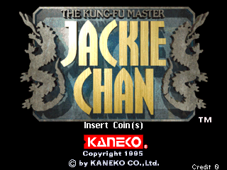
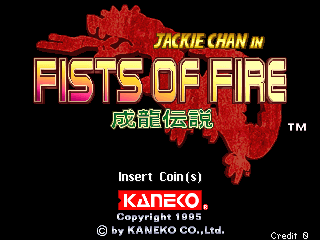

# Jackie Chan for MiSTer

Kaneko's **Jackie Chan - The Kung-Fu Master** (1995; sets `jchan` rev 4 and `jchana` rev 3) and **Jackie Chan in Fists of Fire**
(`jchan2`) for the MiSTer FPGA platform: the board of MAME's `jchan.cpp` -- two 68000s at 16 MHz, the VIEW2 tilemap chip, two
RLE-compressed sprite generators, a YMZ280B, and the "toybox" MCU that Kaneko used for protection and the game's EEPROM.

The core was written from MAME 0.289's driver and device sources, with MAME itself as the reference at every step (the
state of its video chips, RAMs and snapshots of real play are what the simulations are compared with). The 68000s are
[FX68K](https://github.com/ijor/fx68k); the rest -- sprite chips, tilemaps, mixer, toybox, YMZ280B, the SDRAM memory system and the
MiSTer platform layer -- is written here. It is built the same way as the owner's other cores
([metro-mister](https://github.com/decoryah/Arcade-Metro_MiSTer), [taitol-mister](https://github.com/decoryah/Arcade-TaitoLSystem_MiSTer)).

No ROMs or other copyrighted data are in this repository; you supply your own MAME 0.289 `jchan.zip`, `jchana.zip` and
`jchan2.zip`.

## Status

**Run on a real MiSTer (DE10-nano), by one tester.** The repository owner has played all three sets: video, audio and long
play are good, the DIP switches work, the game's settings are saved to and restored from the nvram file, and the picture is
right on a 15 kHz CRT and on HDMI through a RetroTINK 4K in direct video (see "Video timing"). Fast loading, the Scale
options and CRT Adjust work. That is one person's test on one board, not a comparison with the arcade PCB, so please report
what yours shows.

Everything else below is simulation and the Quartus tool flow, against MAME 0.289:

* **Reference renderer.** `tools/jchan_spr.py` and `tools/jchan_tiles.py` (the RLE sprite chips and the VIEW2 tilemaps, ported
  from MAME's `kaneko_rlespr.cpp` / `kaneko_tmap.cpp`) reproduce MAME's own snapshot with **0 differing pixels on 60 real
  frames** of `jchan` and `jchan2` (attract, character select, fights, up to 660 zoomed sprites a frame), and equal MAME's C++
  sprite functions on 6,000+ random sprites. The RTL's sprite chips, tilemaps and mixer are bit-exact against these on the same
  frames and on random lists, with random ROM latency.
* **The machine from reset.** `sim/run_core.sh`: the real 68000 programs, the toybox, both sprite chips, VIEW2, the palette
  and the YMZ280B, through the SDRAM controller and its timing-checked model. Pictures against MAME's snapshots: **110 of 113
  (`jchan`, 1,006 frames), 102 of 103 (`jchana`, 700), 62 of 62 (`jchan2`, 700) pixel-identical** -- boot messages, logos,
  full-screen images, scene changes, scrolling text -- with every CPU-visible memory identical at the frames compared (50 to
  300, every 10) except three or four bytes of a free-running counter and stack residue, and the video memories equal from
  frame 42 on except one CPU-timing frame. The pictures that differ are boot and CPU-timing frames: the video
  RAM test's colour bars of `jchan` frames 5-7 (324 pixels; the RTL's two CPUs run a few microseconds apart from MAME's
  there) and one line of `jchana` frame 441 that appears a frame later (434 pixels). `tools/rtl_selfcheck.py` renders the RTL's
  *own* dumped state of every picture through the reference model and finds **0 differing pixels in all 278** of them: the video
  path is exact, what is left is the CPUs' timing.
* **Toybox.** `rtl/jchan_toybox.sv` against MAME's: 163 generated cases on each set plus every command a real boot and game
  start issue (17 / 17 / 33), the whole 64 KB RAM compared; byte-order quirks included.
* **YMZ280B.** Bit-exact (both channels' 28-bit sums, every sample) against MAME's chip code on a 70 s captured session and on
  random register stress including PCM16.
* **ROM path and MRAs.** `tools/mra_verify.py` assembles every MRA's ROM stream from the merged zips the way MiSTer's loader does and
  compares it with the SDRAM image the simulations ran on: all three identical.
* **The MiSTer top level.** `sim/run_emu.sh`: `Jchan.sv` itself (only `hps_io`, the PLL and `arcade_video` stubbed) with the
  ROM image streamed in or read back from a modelled DDR3 (the fast load), the DIP byte and an nvram file. The SDRAM holds
  exactly the reference image in every loaded window (0 mismatching bytes), the machine is released and boots, and the
  pictures are MAME's. CRT Adjust's H-Size / H-Position / V-Shift and the Scale sizes are checked here too.
* **Quartus Prime Lite 17.0.2** (MiSTer's toolchain) compiles the project for the 5CSEBA6U23I7: 67 % of the ALMs (28,269 of
  41,910), 98 % of the block RAM (540 of 553 M10K), 49 DSPs, and timing closes at 96 MHz in all four models (setup +0.296 ns
  slow 100 C, +0.145 slow -40 C, +4.96 / +5.78 fast; hold >= +0.037). `releases/` has each release's fitter and timing summaries.

## Screenshots

The title screens of the two games, as MAME 0.289 draws them (320 x 240; the core's pictures are compared with MAME's
snapshots, see "Status").

| | |
|---|---|
|  |  |
| Jackie Chan - The Kung-Fu Master (`jchan`; `jchana` is the same game, rev 3) | Jackie Chan in Fists of Fire (`jchan2`) |

## Release history

**20261014** -- the first release. The core as described under "Status"; run on a DE10-nano by the repository owner (all three sets, DIP
switches, nvram, a 15 kHz CRT, a RetroTINK 4K in direct video, fast loading, Scale and CRT Adjust). Fitter and timing summaries:
`releases/jchan_20261014.fit.summary`, `.sta.summary` and `.corners.txt` (setup +0.145 ns in the slowest of the four models). Before it,
three private test builds (20261013, 20261013a, 20261013b) found and fixed the RetroTINK 4K's shaky picture in direct video: see "Video timing".

**20261021** -- the MRAs name the four buttons Weak Punch, Strong Punch, Weak Kick and Strong Kick (the driver's own names for buttons 1-4;
they were Button 1-4). Nothing else changed: the RBF is `jchan_20261014.rbf`, the same bitstream.

## Install

1. Unzip `Jchan_MiSTer_20261021.zip` over the root of the SD card (adds the MRAs to `_Arcade/` and `_Arcade/cores/jchan_20261014.rbf`),
   or copy by hand the RBF (`releases/jchan_20261014.rbf`) to `/media/fat/_Arcade/cores/` and the `.mra` files from `mra/` to
   `/media/fat/_Arcade/`. Keep the RBF's `jchan_` name and date: MiSTer finds the core by the MRA's `<rbf>` name plus the date and
   takes the newest if there are several, so delete older `jchan_*.rbf` files.
2. Put your MAME 0.289 `jchan.zip`, `jchana.zip` (clone of `jchan`: keep `jchan.zip` next to it) and `jchan2.zip` in
   `/media/fat/games/mame/`. The merged set works too. No ROMs are distributed.
3. Start the game from the Arcade menu. The 37 MB ROM image is copied to the DDR3 in one go and loaded in about a second with a
   recent Main_MiSTer (see "Fast loading"); the game then boots as on the board.

**A 64 MB (or larger) SDRAM module is required**: the ROM image, including the 24 MB window of the first sprite chip's ROM, and
the decoded-sprite store take about 52 MB of the SDRAM's address space. The core uses the first 64 MB of the module; it was run on
a 128 MB module.

### Fast loading

The three MRAs carry `address="0x32000000"` on the ROM image. A Main_MiSTer that supports that attribute copies the whole
assembled image into the DDR3 in one go instead of streaming it through the HPS port a byte at a time, and the core reads it back
from there into its loader: about 1.4 s in the bench; the streamed load of the 37 MB is estimated at about a minute (from
another core's 17 MB in 23 - 25 s) and the owner found the fast load much faster on the board. There is nothing to set.
A Main_MiSTer that ignores the attribute streams the image as before, with the same RBF and MRAs. How it works:
`docs/mister_top.md`, "Fast load".

## OSD options

| Option | Values | |
|---|---|---|
| Aspect ratio | Original, Full Screen, [ARC1], [ARC2] | Original is 4:3 |
| Scale | Normal, V-Integer, HV-Integer, Narrower HV-Integer, HV-Integer+ | Integer scaling for the HDMI scaler (the framework's `video_freak`; the 15 kHz analog output is not touched). Full Screen with an integer Scale is given the screen's own proportions, so the result is the largest whole-number size in the screen's aspect |
| Scandoubler Fx | None, HQ2x, CRT 25%, CRT 50%, CRT 75% | |
| CRT Adjust | submenu: Off, On; then H-Size 0..+6 / -16..-1, H-Position 0..+20 / -48..-1, V-Shift -16..+15 | rmonic79's module: fits the picture to a 15 kHz analog (CRT) output without the monitor losing sync (the sync pulses keep their rate; the picture goes through a line buffer). Off by default, and then the picture takes the path it always had. Does nothing while the scandoubler is in use. **With it On the HDMI picture follows it and the direct video's pixels are no longer a regular 13 clocks: keep it Off with a RetroTINK 4K in direct video** |
| DIP switches | the board's SW1, from the MRA (below) | |
| Volume | Normal, -6 dB, -12 dB, +6 dB | |
| SDRAM read capture | Normal, Late | Late samples SDRAM reads one clock later, for a module that answers slowly. At this core's clock phase it is expected to make no difference |
| Reset | | Restarts the machine (the ROM stays loaded) |

**DIP switches** (the MRA's `<switches>`, MAME's DSW1):

| SW1 | Name | Values | Default (MAME's) |
|---|---|---|---|
| 1 | Service Mode | On, Off | Off |
| 2 | Flip Screen | On, Off (see "Known differences") | Off |
| 3 | Demo Sounds | On, Off | On |
| 4 | Sound | Mono, Stereo | Stereo |
| 5 | Free Play | On, Off | Off |
| 6 | Blood Mode | High, Normal | High |
| 7 | Special Prize Available (`jchan`, `jchana`) / Unused (`jchan2`) | Yes, No | No |
| 8 | Buttons Layout | 2+2, 3+1 (`jchan2` ignores it) | 3+1 |

**Controls.** Joystick directions and four buttons -- Weak Punch, Strong Punch, Weak Kick, Strong Kick (the driver's own names for
buttons 1-4; default mapping A / B / X / Y) -- Start and Coin (Select);
two players. From the keyboard: 1 / 2 start, 5 / 6 coin, 9 service, F1 / F2 the test switch, T tilt (MAME's defaults), on top of
MiSTer's usual keyboard-as-joystick. The game's own settings live in its EEPROM: a 128-byte file `config/nvram/<MRA name>.nvm`,
written about a second after the game stores them (at the first boot about 7 s in) and loaded again the next time.

## Video timing

The pixel clock of the board is 28.636363 MHz / 4 = 7.159 MHz and the raster 460 x 261 dots (320 x 240 visible), 59.63 Hz (the
PCB's measured 59.60 Hz, 15.556 kHz). The core runs at 96 MHz, which is 13.41 clocks to a dot, so the dot enable has to
be made. A first version made it numerically (13 or 14 clocks apart, a different pattern in every line); the CRT and the framework's
scandoubler did not mind, but a RetroTINK 4K in direct video (DV1), which samples the 96 MHz pixel stream, showed a very shaky
picture. The dots are now exactly **13 clocks apart, every line is exactly 6168 clocks, and the fraction of the whole frame
(about 99 clocks) is added to one line in the vertical blanking** (line 255, as the SNES does with its long and short lines):
the average line time, the frame rate and the CPUs' clocks per frame are unchanged, and the picture is steady on the RT4K.
The cost is that the active picture is 320 x 13 clocks instead of 320 x 13.41: about 3 % narrower than the PCB's on a CRT, which
CRT Adjust's H-Size can take back. The HSync / VSync positions inside the blanking are not measured from the PCB
(hsync dots 340-371, vsync lines 244-246); only the totals and the picture are MAME's. `docs/mister_top.md`, "The pixel enable".

## Known differences and limits

* **Flip Screen (DIP SW1:2).** The two sprite chips flip, VIEW2's tilemap flip bits are not modelled (they are not in the
  reference either), so with the switch On the picture is only half turned over. Leave it Off.
* **The watchdog** is accepted and ignored. A game that relied on it to reset the machine would not.
* **CPU timing.** At some instants (the boot frames listed under "Status") the RTL's two CPUs are a few microseconds apart
  from MAME's, which shows as a line or a colour-bar frame one frame early or late; the video path itself is exact for the
  state the CPUs leave.
* **Not compared with the arcade PCB.** MAME is the reference; the driver itself says that parts of this hardware are not
  understood (`docs/hardware.md` marks what was verified against MAME and what is taken from the driver).
* The simulation comparisons against MAME cover the boot and the first 12 - 17 s of emulated time of each set from reset
  (700 to 1,006 frames), and 60 real frames of play; the hardware tests cover long play.

## Repository layout

| path | what |
|---|---|
| `Jchan.sv`, `Jchan.qpf`, `Jchan.qsf`, `Jchan.sdc`, `files.qip`, `rtl/pll*`, `sys/` | the MiSTer top (`emu`) and its Quartus project: PLL, hps_io, loader remap, inputs, nvram, audio, video, fast load, Scale, CRT Adjust; `sys/` is the framework, unchanged; `docs/mister_top.md` |
| `rtl/jchan_core.sv`, `jchan_m68k.sv`, `jchan_board.sv`, `jchan_sys.sv`, `jchan_cen.sv`, `jchan_ram.sv`, `jchan_io.sv` | the CPU side and the whole core (minus the memory controller); `docs/cpu_side.md` |
| `rtl/jchan_view2.sv`, `jchan_mix.sv`, `jchan_video.sv`, `jchan_spr_dec.sv`, `jchan_spr_band.sv`, `jchan_spr.sv` | VIEW2 tile line renderer, sprite / tile mixer, the video top; the RLE sprite chip (pass 1 decodes each list once into an SDRAM store, pass 2 draws 16-line bands); `docs/video.md`, `docs/rle_sprites.md`, `docs/memory.md` |
| `rtl/jchan_toybox.sv`, `rtl/jchan_ymz280b.sv`, `rtl/jchan_audio48.sv` | the toybox MCU, the sound chip, its 83.33 kHz -> 48 kHz output stage; `docs/toybox.md`, `docs/sound.md` |
| `rtl/jchan_sdram.sv`, `rtl/jchan_mem.sv`, `rtl/jchan_fastload.sv` | SDRAM controller (64 MB, CL2), the ROM / store clients and the loader, the DDR3 fast load; `docs/memory.md` |
| `rtl/jchan_standby.sv` | the blank raster shown while the machine is held (the OSD's "Loading" pop-up needs a sync) |
| `rtl/jchan_rle.sv` | the RLE sprite chip as one whole-frame-bitmap engine (a second implementation of the same behaviour, not used by the core any more) |
| `modules/` | vendored FX68K and CRT Adjust (`modules/VENDOR.md`) |
| `mra/`, `tools/make_mra.py`, `tools/mra_verify.py`, `tools/mra_build.py` | the three MRAs (`jchan`, `jchana` in `_alternatives`, `jchan2`), their generator from MAME's definitions, and the check that every MRA assembles to the simulated SDRAM image |
| `sim/` | Verilator benches: sprite chips, video, toybox, YMZ280B, memory system, CPU side, whole core (`run_core.sh`), the MiSTer top level (`run_emu.sh`), the SDRAM model |
| `tools/` | reference renderers (`jchan_spr.py`, `jchan_tiles.py`), MAME Lua dump / snapshot tools, comparison tools (`sys_compare.py`, `rtl_selfcheck.py`, `vga_check.py`), MRA / ROM image builders, `regress.py` |
| `quartus/` | the core alone (virtual pins) for quick fit / timing experiments, and the four-corner timing scripts |
| `releases/` | each release's RBF with its fitter and timing summaries |
| `docs/` | hardware map, toybox, sprite chips, video, sound, memory system, CPU side, the MiSTer top |

## Building

Quartus Prime Lite 17.0.2 (the version MiSTer's framework is built with):

```
quartus_sh --flow compile Jchan
```

`Jchan.qsf` has the fitter seed that closes timing (`SEED`; the design sits within a few tenths of a nanosecond of 96 MHz, so
a source change may need another seed); `quartus_sta -t quartus/sta_corners.tcl` runs the four timing models.
`tools/make_mra.py` regenerates the MRAs from MAME's definitions (no ROM file is read). The tools need Python 3.8, MAME 0.289
(`JCHAN_MAME`), the merged ROM folder (`JCHAN_ROMS`) and, for the benches, Verilator 5 and a C++ compiler in WSL or Linux;
`tools/paths.py` holds the locations. `tools/regress.py` runs the quick benches (toybox, io, audio48, YMZ280B stress, memory system,
sprite chips). The whole-core bench simulates the machine from reset against MAME's dumps:
`py -3.8 tools/sys_compare.py <set> mame|rtl|cmp|pic` (`docs/cpu_side.md`).

## Credits

* **The MAME team** -- the driver and device sources everything here was derived from and checked against: `jchan.cpp`
  (David Haywood), `kaneko_rlespr.cpp` (David Haywood), `kaneko_tmap.cpp` (Luca Elia, David Haywood), `kaneko_toybox.cpp`
  (David Haywood, Luca Elia, Sebastien Volpe), `ymz280b.cpp` (Aaron Giles); MAME's sources are BSD-3-Clause.
* **Jorge Cwik** -- FX68K, the cycle-accurate 68000 (GPL-3.0), vendored under `modules/cpu-fx68k`.
* **rmonic79** (Umberto Parisi), with help from **Andrea Bogazzi** (asturur) --
  [MiSTer-CRT-Adjust](https://github.com/rmonic79/MiSTer-CRT-Adjust), the module behind the CRT Adjust options
  (`modules/crt-adjust/crt_adjust.sv`; GPL-3.0 or later).
* **plasticbugs** -- the ROM-stream builder `tools/mra_build.py` (from the
  [analogue-pocket-gaiapolis](https://github.com/plasticbugs/analogue-pocket-gaiapolis) core, GPL-3.0).
* **Sorgelig** and the MiSTer team -- the framework (`sys/`, GPL).
* **Claude** (Anthropic's AI model, used through Claude Code) -- written together with the repository owner: the reference
  renderers, the RTL, the memory system, the MiSTer layer, the MRAs, the benches and this documentation.

## Licence

Copyright (C) 2026 decoryah. GPL-3.0 (see `LICENSE`). The vendored FX68K (GPL-3.0) and CRT Adjust (GPL-3.0 or later) in `modules/`
keep their own licences (`modules/VENDOR.md`), and the MiSTer framework in `sys/` is GPL (see the headers of its files).
